  

  

## How I work

- I  start a project once I'm 100% invested in it.
- That means fewer repos here, but each one is something I cared about building.
- If it's on this page, I liked making it.
# 📊 GitHub Stats:
 
 

---

<!-- Proudly created with GPRM ( https://gprm.itsvg.in ) -->
